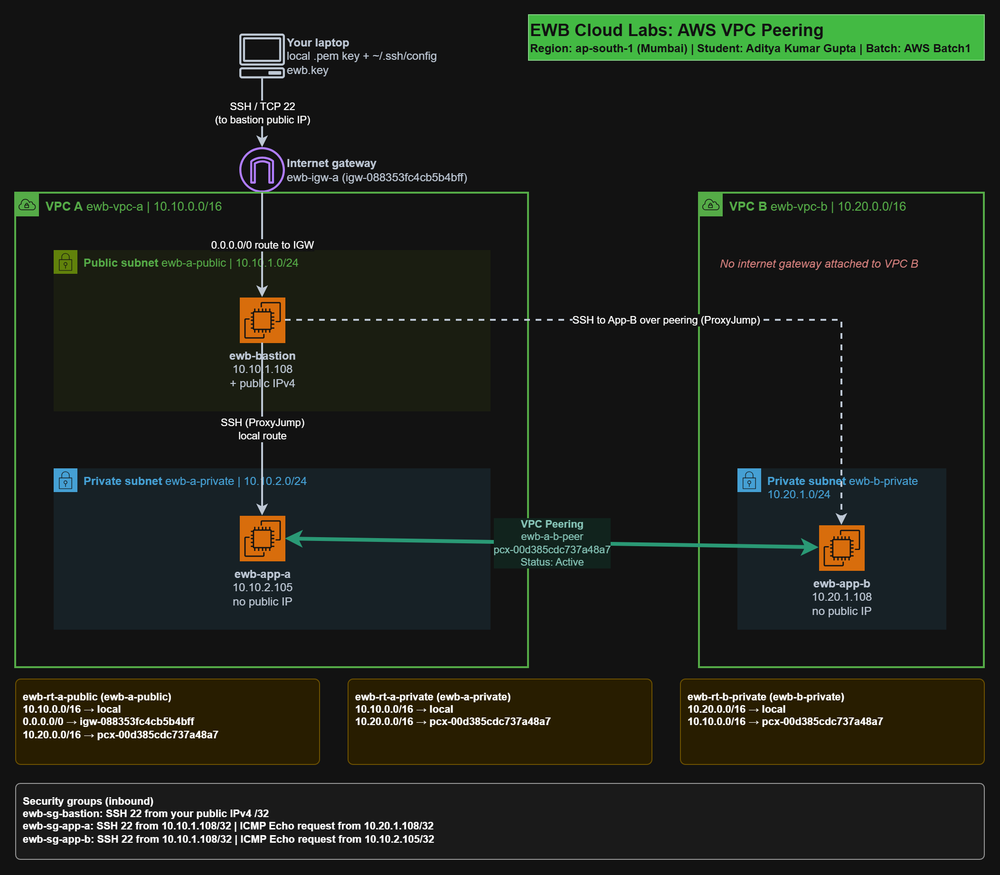

# AWS VPC Peering: EWB Cloud Labs

**Name:** Aditya Kumar Gupta | **Batch:** AWS Batch1 | **Region:** ap-south-1 (Mumbai) | **Completed:** 23 October 2026

Two VPCs (10.10.0.0/16 and 10.20.0.0/16) connected with VPC peering. One public bastion in VPC A gives SSH access (ProxyJump) to private EC2 instances in both VPCs. App-A and App-B have no public IP, and all instance-to-instance tests use private IPs. All AWS resources were deleted after the lab.

## Results

| Test | Result |
|---|---|
| Baseline ping App-A to App-B before peering | 100% packet loss |
| Forward ping App-A to App-B after routes | 0% packet loss |
| Reverse ping App-B to App-A after routes | 0% packet loss |
| SSH to App-B through the bastion | shell opened |
| Controlled failure: ICMP rule removed on App-B | 100% packet loss from App-A |

## Contents

- [Report PDF](Aditya_Kumar_Gupta_EWB_VPC_Peering.pdf)
- [Resource inventory](docs/resource-inventory.md)
- [Route tables](docs/route-tables.md)
- [Security groups](docs/security-groups.md)
- [Test results](docs/test-results.md)
- [Concepts explained](docs/concepts-explained.md)
- [Cleanup and learnings](docs/cleanup-and-learnings.md)
- [Screenshots](screenshots/) and [terminal output](terminal-output/)
- [SSH config example](config/ssh-config-example) (no keys included)

## Notes

- The private key (.pem) is not in this repository.
- Instances used AWS-assigned private IPs (10.10.1.108, 10.10.2.105, 10.20.1.108), and all rules use these actual values.

## Thanks you....
## Review all docs and if any doubts you can dm and Give a Star to this repo.... and connect for more such content